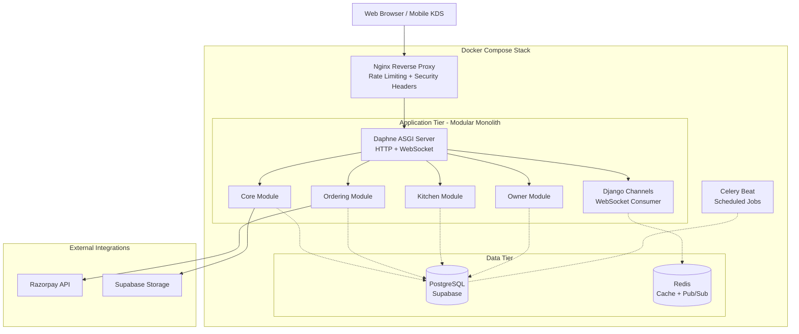
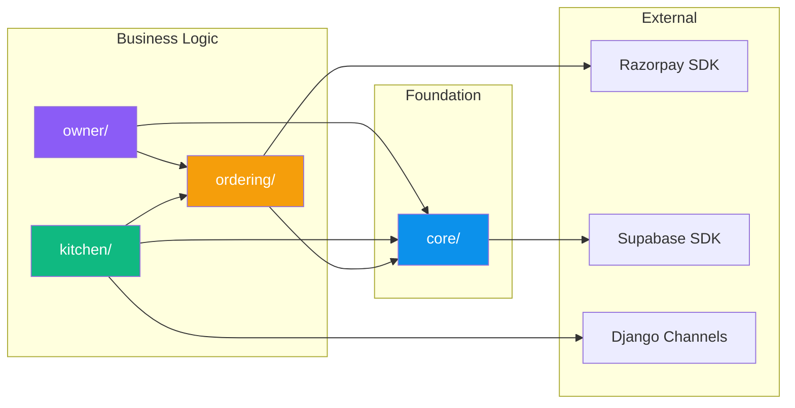
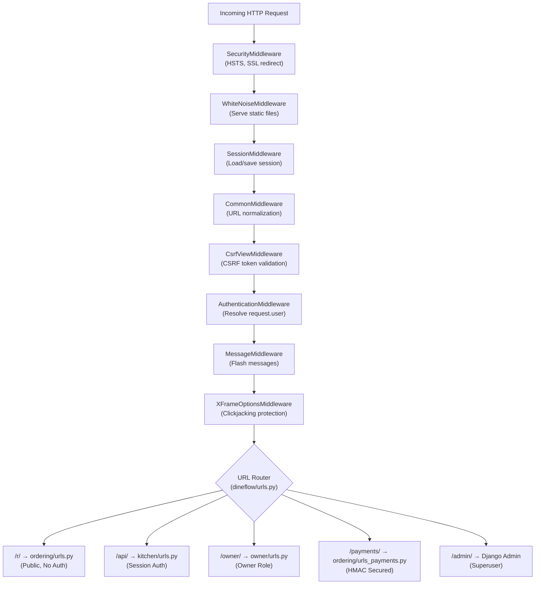
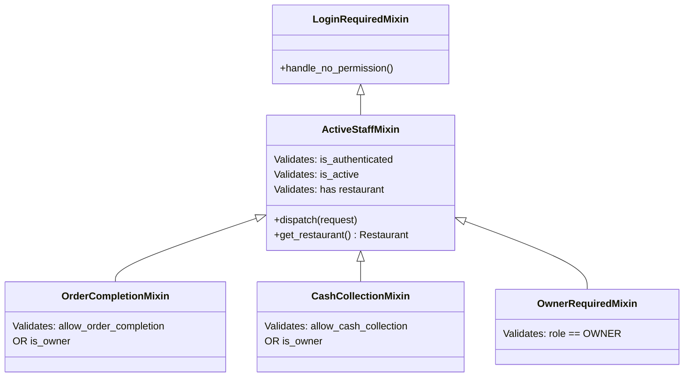
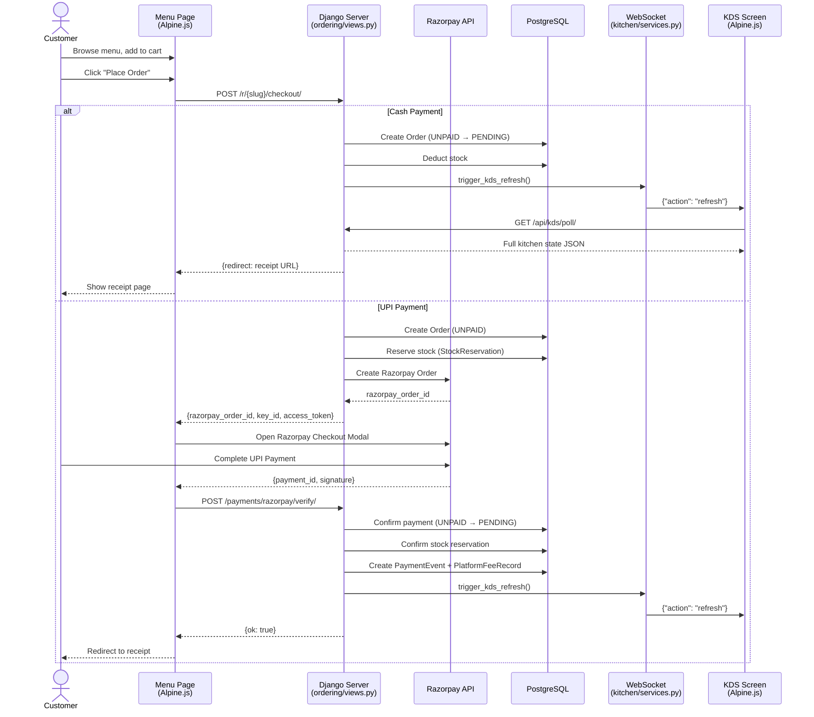
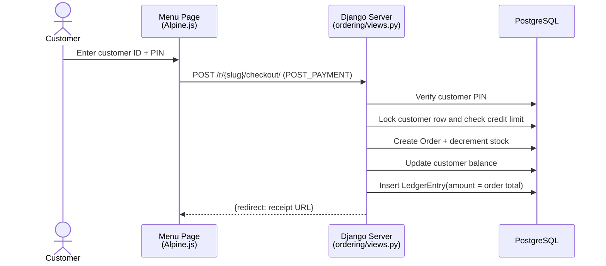

# Order-Flow Architecture Document

Last updated: 2026-05-14

This document provides a comprehensive overview of the Order-Flow architecture, acting as the primary source of truth for the system's structural boundaries, module dependencies, and execution paradigms.

## 1. Architectural Paradigm

Order-Flow is structured as a **Modular Monolith**.

Rather than adopting a distributed microservices architecture prematurely, Order-Flow leverages Django apps as bounded contexts (Modules). This ensures strong consistency, simplified operational overhead, and transactional integrity while keeping the codebase decoupled enough for future microservice extraction if required.

### Key Architectural Tenets
1. **Database-as-the-Integrator**: Modules communicate primarily via Foreign Key relationships and shared transactions, ensuring data integrity.
2. **Synchronous Core, Asynchronous Edge**: Business logic runs synchronously in Django workers. Asynchronous events (like KDS refreshes and payment fan-out) are pushed to the edge using ASGI WebSockets and background jobs.
3. **Thick Backend, Thin Client**: We avoid complex SPA frameworks (React/Angular) in favor of Server-Side Rendered (SSR) HTML augmented with Alpine.js.

---

## 2. High-Level System Topology

---

## 3. Bounded Contexts (Modules)

The system is strictly divided into the following Django apps:

### 3.1 Core Module (`core/`)
- **Responsibility**: System foundation. 
- **Domain Entities**: `User`, `Restaurant`, `RestaurantConfig`, `MenuItem`, `AddOn`, `PlatformSettings`.
- **Rules**: Other modules can depend on `core`, but `core` must *never* import models from other modules (preventing circular dependencies).

### 3.2 Ordering Module (`ordering/`)
- **Responsibility**: Processing checkouts, payment state machines, post-payment booking, and cart logic.
- **Domain Entities**: `Order`, `OrderItem`, `OrderItemAddOn`, `StockReservation`, `PaymentTransaction`, `PaymentAttempt`, `WebhookLog`, `LedgerEntry`.
- **Rules**: Owns the payment lifecycle. Communicates with Razorpay and other providers through the payment service layer.

### 3.3 Kitchen Module (`kitchen/`)
- **Responsibility**: The Kitchen Display System (KDS).
- **Domain Entities**: None (Read-Only access to `ordering` models).
- **Rules**: Powered by Django Channels. Pushes WebSocket events. Provides highly optimized JSON APIs for Alpine.js polling.

### 3.4 Owner Module (`owner/`)
- **Responsibility**: Restaurant administration, reporting, and staff management.
- **Domain Entities**: None (Operates on `core` and `ordering` models).

---

## 4. Cross-Cutting Concerns

### 4.1 Idempotency & Concurrency
Order creation and payment webhooks are heavily guarded.
* **Idempotency Keys**: The `Order` model enforces a unique `idempotency_key` constraint to prevent double-billing during network retries.
* **Payment Access Tokens**: Public payment status and retry endpoints require a signed, per-payment token in addition to tenant/session checks.
* **Database Locking**: Features like item preparation status (`StartPrepView`) use `select_for_update()` to prevent race conditions when multiple chefs tap the exact same item simultaneously.

### 4.2 Multi-Tenancy
Data isolation is currently enforced at the application level (Logical Isolation). Every critical model contains a `restaurant` ForeignKey. 
* *Future Consideration*: If compliance requires it, Row-Level Security (RLS) can be enabled in Supabase to enforce this at the database engine level.

### 4.3 Payment Isolation and Replay Safety
* Payment credentials are resolved per restaurant and per provider mode.
* Webhook processing is deduplicated using provider event IDs, payload hashes, and locked state transitions.
* KDS WebSocket groups are restaurant-scoped.
* Production WebSocket connections are origin-validated by `AllowedHostsOriginValidator`.
* Critical owner-side mutations now write an append-only audit trail via `OwnerAuditLog` so payment config and staff permission changes are reviewable after the fact.
* Payment configuration secrets are stored separately from the human-readable config surface and must never be echoed back into audit logs, templates, or API responses.

### 4.4 Real-Time Infrastructure (WebSockets)
We employ a **WebSocket-Triggered Polling** pattern.
1. A mutation occurs (e.g., New Order created).
2. The server sends a lightweight ping `{"action": "refresh"}` over WebSockets to the specific restaurant's channel group.
3. The KDS clients receive the ping and trigger an HTTP `fetch()` to retrieve the latest state.
*This prevents massive JSON blobs from congesting the WebSocket channels and guarantees state eventual consistency.*

Payment state updates reuse the same restaurant-scoped channel group via a separate `payment_update` event so dashboards can refresh without exposing cross-tenant payloads.

---

## 5. Deployment Model

Order-Flow is containerized using Docker for reproducible deployments:

* **Container Runtime**: Multi-stage Docker build with Python 3.12-slim. Non-root user.
* **ASGI Server**: Daphne handles both HTTP and WebSocket traffic on port 8000.
* **Reverse Proxy**: Nginx serves static files, terminates SSL, enforces rate limits, and proxies to Daphne.
* **Cache / Real-Time**: Redis 7 (shared cache and Django Channels layer).
* **Database**: Hosted PostgreSQL via Supabase connection pooler (PgBouncer).
* **Static/Media**: WhiteNoise (static) via Nginx, Supabase Buckets (media/images).
* **Scheduled Jobs**: Celery Beat runs periodic tasks including `release_expired_reservations` every 5 minutes, payment expiry, reconciliation, and monthly statement sync.
* **Health Probes**: `/healthz/live/` and `/healthz/ready/` endpoints. Dockerfile `HEALTHCHECK` configured.

See `docs/DEPLOYMENT_GUIDE.md` and `docs/DOCKER_DEPLOYMENT.md` for complete deployment instructions.

---

## 6. Module Dependency Graph

**Rule**: Arrows point in the direction of dependency. `core/` is the foundation layer — it must NEVER import from `ordering/`, `kitchen/`, or `owner/`.

---

## 7. Middleware Pipeline (Request Processing Order)

---

## 8. RBAC Mixin Hierarchy

| View | Mixin Used | Who Can Access |
|:-----|:-----------|:---------------|
| `KDSView` | `ActiveStaffMixin` | All active staff + owners |
| `KDSPollView` | `ActiveStaffMixin` | All active staff + owners |
| `StartItemPrepView` | `OrderCompletionMixin` | Staff with `allow_order_completion` + owners |
| `CashCollectView` | `CashCollectionMixin` | Staff with `allow_cash_collection` + owners |
| Owner Dashboard views | `OwnerRequiredMixin` | Owners only |

---

## 9. End-to-End Checkout Flow

### 9.1 Post-Payment Balance Flow

