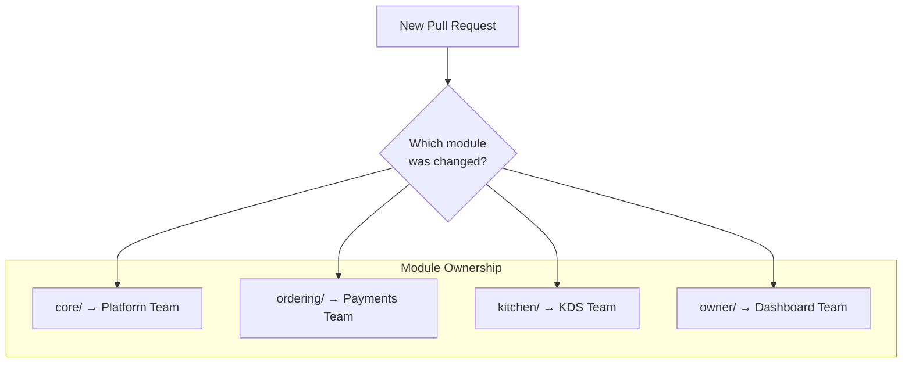

# Order-Flow Contributing Guidelines

This document establishes the engineering standards for contributing code to the Order-Flow platform. All contributors—including full-time engineers, contractors, and AI agents—must follow these guidelines.

---

## 1. Branch Strategy

```mermaid
gitgraph
    commit id: "main (stable)"
    branch feature/add-table-management
    commit id: "Add Table model"
    commit id: "Add Table CRUD views"
    commit id: "Add tests"
    checkout main
    merge feature/add-table-management id: "PR #42 merged"
    branch hotfix/webhook-signature
    commit id: "Fix HMAC comparison"
    checkout main
    merge hotfix/webhook-signature id: "Hotfix merged"
```

| Branch Pattern | Purpose | Base Branch |
|:---|:---|:---|
| `feature/<name>` | New features | `main` |
| `hotfix/<name>` | Critical production fixes | `main` |
| `refactor/<name>` | Non-functional improvements | `main` |

- **Never commit directly to `main`.**
- All changes must go through a Pull Request with at least one approving review.

---

## 2. Pull Request Requirements

### 2.1 PR Checklist
Before requesting a review, ensure:

- [ ] **Tests pass locally**: `python manage.py test`
- [ ] **Migrations generated**: `python manage.py makemigrations` (if models changed)
- [ ] **No hardcoded secrets**: Grep for API keys, passwords, or tokens
- [ ] **RBAC tested**: Verified the feature works correctly for both `OWNER` and `STAFF` roles
- [ ] **Prefetch verified**: If you modified a View that queries related objects, ensure `select_related()` / `prefetch_related()` are used

### 2.2 PR Description Template
```markdown
## What does this PR do?
Brief description of the change.

## Why is this change needed?
Business context or bug report reference.

## How was this tested?
- Logged in as OWNER → verified X
- Logged in as STAFF → verified Y
- Ran `python manage.py test ordering`

## Screenshots (if UI change)
Attach before/after screenshots.

## Checklist
- [ ] Migrations committed
- [ ] No N+1 queries introduced
- [ ] Existing tests pass
```

---

## 3. Code Standards

### 3.1 Python
- **Style**: Follow PEP 8. Line length limit: 120 characters.
- **Imports**: Use absolute imports. Group them: stdlib → Django → third-party → local apps.
- **Docstrings**: Required for all public classes and functions.
- **Type Hints**: Encouraged but not strictly enforced (yet).

### 3.2 Templates (HTML)
- Use Django template tags, not inline JavaScript, for server-rendered pages.
- Alpine.js is permitted **only** in the KDS template (`kitchen/templates/kitchen/kds.html`).
- Never use the `|safe` template filter on user-generated content.

### 3.3 Database
- **All mutations** must be wrapped in `transaction.atomic()`.
- **All queries fetching related objects** must use `select_related` or `prefetch_related`.
- **Raw SQL is forbidden** without explicit Security team approval.

---

## 4. Module Ownership & Code Review



When a PR touches multiple modules, **all** affected module owners must approve.

### Critical Files (Require Senior Engineer Review)
| File | Reason |
|------|--------|
| `ordering/views.py` (Webhook) | Financial integrity |
| `ordering/services.py` | Payment state machines |
| `kitchen/views.py` (`KDSPollView`) | N+1 query prevention, caching |
| `core/mixins.py` | Authorization enforcement |
| `dineflow/settings/prod.py` | Security configuration |

---

## 5. Commit Message Convention

Use the format: `<type>(<scope>): <description>`

```
feat(kitchen): add version-based caching to KDSPollView
fix(ordering): prevent double-charge via idempotency_key constraint
refactor(core): extract RBAC logic into dedicated mixins
docs(runbook): add stale reservation cleanup procedure
```

### Types
| Type | Usage |
|------|-------|
| `feat` | New feature |
| `fix` | Bug fix |
| `refactor` | Code restructuring (no behavior change) |
| `docs` | Documentation only |
| `test` | Adding or fixing tests |
| `chore` | Maintenance (dependencies, CI config) |

---

## 6. Security Contribution Rules

- **Never** commit `.env` files, API keys, or database credentials.
- **Never** add the `|safe` template filter to user-generated content.
- **Never** use `csrf_exempt` on any endpoint that is not a verified webhook.
- **Always** use `bleach.clean()` when saving user-provided text to the database.
- If you discover a security vulnerability, **do not** open a public issue. Report it privately to the Platform Team lead.
