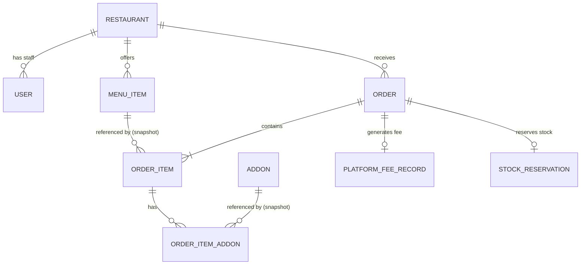

# Order-Flow Database Design & Entity Mapping

Order-Flow utilizes **PostgreSQL** (hosted via Supabase) as its primary operational data store. This document details the schema, relationships, performance strategies, and constraints used to maintain data integrity.

## 1. Schema Overview

The database is highly relational, enforcing strict referential integrity. All primary keys are `UUIDv4` to ensure global uniqueness and prevent enumerable ID enumeration attacks.

### 1.1 Core Entities (`core/models.py`)

*   **`Restaurant`**: The root tenant object. Everything isolates back to this.
*   **`User`**: Custom user model inheriting from `AbstractUser`. Bound to a specific `Restaurant`. Contains RBAC fields (`allow_cash_collection`, `allow_order_completion`).
*   **`RestaurantConfig` & `RestaurantPaymentConfig`**: One-to-One extensions of the Restaurant model holding operational toggles and Razorpay secrets.
*   **`MenuItem` & `AddOn`**: The catalog. `MenuItem` contains a `restaurant` FK and an optional `ItemType` FK.
*   **`PlatformFeeRecord`**: An **append-only ledger**. Captures the fee taken from each order. Contains a `fee_rate_snapshot` to ensure historical financial reporting remains accurate even if platform settings change.

### 1.2 Ordering Entities (`ordering/models.py`)

*   **`Order`**: Tracks the checkout session. Includes an `idempotency_key` (UUID) to strictly prevent double-charging.
*   **`OrderItem` & `OrderItemAddOn`**: The items within an order. 
    *   *Critical Design Choice*: These models **snapshot** the item names and prices (`menu_item_name`, `unit_price`). We NEVER use the FK relationship to calculate historical order totals, as menu prices may change in the future.
*   **`StockReservation`**: Handles inventory concurrency. When an order is placed, stock is temporarily reserved. If payment fails or times out, a background cron job releases the stock.
*   **`PaymentTransaction`**: Canonical payment record for provider state, idempotency, and retries.
*   **`PaymentAttempt`**: Per-attempt channel/method metadata (QR, UPI intent, hosted) for operational debugging.
*   **`WebhookLog`**: Append-only webhook ingestion audit with signature validity, payload hash, and processing status.
*   **`TenantPaymentConfig`**: Per-restaurant payment provider credentials (encrypted at rest).
*   **`LedgerEntry`**: Customer balance ledger where positive `amount` means dues, negative `amount` means settlement/payment.

### 1.3 Customer Balance Semantics (`core.Customer.balance`)

- `balance > 0`: Customer owes the restaurant (dues).
- `balance < 0`: Customer has advance/prepaid credit.
- `balance = 0`: Customer is fully settled.

Post-payment orders increase balance (debt), manual/customer payments reduce balance.

---

## 2. Entity-Relationship Diagram



---

## 3. Performance & Indexing Strategy

To ensure rapid queries during peak hours, Order-Flow employs targeted indexing strategies.

### 3.1 Composite Indexes
Because Order-Flow is a multi-tenant system, almost all reads are filtered by `restaurant_id`. Therefore, composite indexes are used heavily.

```python
class Meta:
    indexes = [
        # Optimized for KDS active order queries
        models.Index(fields=['restaurant', 'status']),
        # Optimized for Owner Dashboard daily reports
        models.Index(fields=['restaurant', 'created_at']),
        # Optimized for post-payment customer status scans
        models.Index(fields=['restaurant', 'is_blocked', 'is_post_payment_enabled']),
        # Optimized for ledger timeline queries
        models.Index(fields=['restaurant', 'customer', 'created_at']),
    ]
```

### 3.2 Payment Table Constraints

- `PaymentTransaction.idempotency_key` is unique.
- `WebhookLog` dedupes by `(restaurant, provider, payload_hash)`.
- `PaymentAttempt` dedupes by `(payment_transaction, attempt_no)`.
- `TenantPaymentConfig` dedupes by `(restaurant, provider, mode)`.

These constraints prevent duplicate billing side-effects and ensure deterministic replay behavior under provider retries.

### 3.2 The N+1 Problem Prevention
The Kitchen Display System must render complex nested data (`Order` -> `OrderItem` -> `OrderItemAddOn`). Without optimization, this requires hundreds of queries per page load.
*   **Solution**: We enforce `prefetch_related` and `select_related` at the View boundary.
*   See `KDSPollView` in `kitchen/views.py`: It utilizes nested `Prefetch` objects to fetch all orders, items, and addons for a restaurant in exactly 3 queries, regardless of how many orders exist.

---

## 4. Concurrency & Data Integrity

Order-Flow operates in a high-concurrency environment where multiple chefs might attempt to interact with the same order simultaneously.

### 4.1 Database Locking
When mutating an order's status (e.g., `CompleteItemView`), the system utilizes PostgreSQL row-level locking via Django's `select_for_update()`.
1. A transaction is opened: `with transaction.atomic():`
2. The row is locked: `OrderItem.objects.select_for_update().get(id=X)`
3. Status is mutated.
4. Transaction commits and lock is released.
*This prevents race conditions where two chefs tap the exact same item on two different iPads at the exact same millisecond.*

### 4.2 Idempotency Guards
Network latency can cause mobile browsers to send the "Submit Order" payload twice. 
The database enforces a `UNIQUE` constraint on `Order.idempotency_key`. The second request will instantly trigger a database integrity error, protecting the customer from being double-charged.
