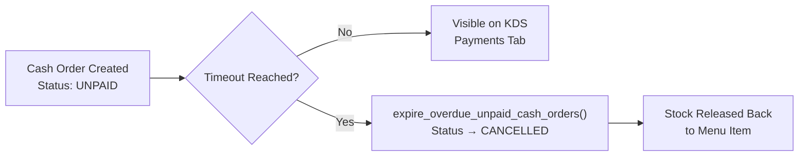
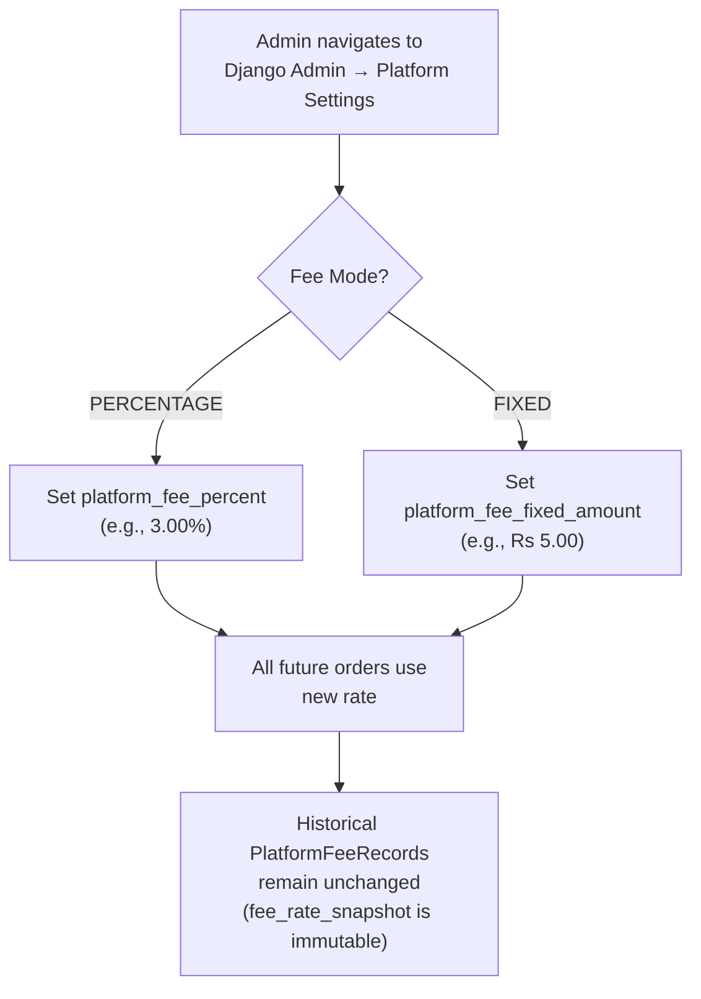
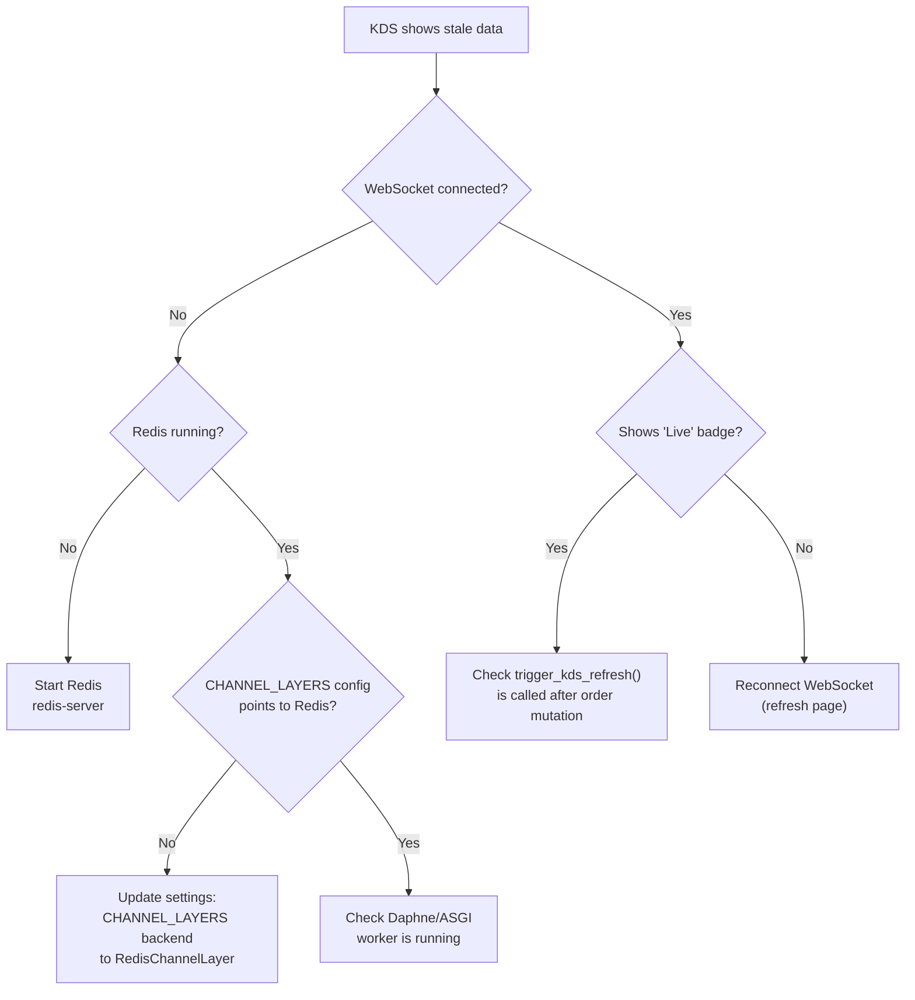

# Order-Flow Runbook

Last updated: 2026-05-08

Standard Operating Procedures (SOPs) for routine maintenance, scheduled tasks, and common administrative operations.

> **Note**: All commands assume Docker Compose deployment. For non-Docker setups, replace `docker compose exec web` with direct `python manage.py` calls.

---

## 1. Daily Operations

### 1.1 Order Counter Reset
Order-Flow automatically resets the daily order counter per restaurant. The `RestaurantOrderCounter` model tracks `last_reset` date. When the first order of the day arrives, the counter resets to `1`.

**No manual intervention required** — but if a counter gets stuck:
```bash
docker compose exec web python manage.py shell
>>> from ordering.models import RestaurantOrderCounter
>>> counter = RestaurantOrderCounter.objects.get(restaurant__slug='your-slug')
>>> counter.last_number = 0
>>> counter.last_reset = None
>>> counter.save()
```

### 1.2 Expired Cash Order Cleanup



Cash orders that are not collected within the `cash_payment_timeout_minutes` window (default: 10 minutes) are automatically cancelled. This is triggered by `expire_overdue_unpaid_cash_orders()` which runs during every `KDSPollView.get()` request and every `ReceiptView.get()` request.

### 1.3 Stale UPI Reservations
If a Razorpay checkout is initiated but the webhook never arrives (e.g., customer abandons the Razorpay modal), `StockReservation` records will expire after 15 minutes.

**Check for stale reservations:**
```bash
docker compose exec web python manage.py shell
>>> from ordering.models import StockReservation
>>> from django.utils import timezone
>>> stale = StockReservation.objects.filter(
...     is_confirmed=False, expires_at__lt=timezone.now()
... )
>>> print(f"Stale reservations: {stale.count()}")
```


> **Note**: The `dineflow-cron` container runs `release_expired_reservations` every 5 minutes, handling both UPI and cash order expiry automatically.

---

## 2. Platform Administration

### 2.1 Platform Fee Configuration



Platform fee settings are managed via the Django Admin panel at `/admin/core/platformsettings/`. Because `PlatformSettings` is a singleton model (enforced via `singleton_key=1`), only one row ever exists.

### 2.2 Restaurant Onboarding
To onboard a new restaurant:
1. Create the `Restaurant` record in Django Admin.
2. A `RestaurantConfig` and `RestaurantPaymentConfig` are auto-created via `post_save` signal.
3. Create an `OWNER` User, attaching them to the restaurant.
4. The Owner can then log in and configure their menu, staff, and payment settings.

### 2.3 Staff Account Management
Owners manage staff from the Owner Dashboard (`/owner/staff/`). Key operations:
- **Create Staff**: Set username, password, and permission toggles.
- **Toggle Permissions**: `allow_cash_collection`, `allow_order_completion`, `allow_view_all_orders` can be toggled inline without navigating to a separate page.
- **Deactivate Staff**: Set `is_active=False`. The session immediately becomes invalid.

---

## 3. Troubleshooting Quick Reference

### 3.1 KDS Not Updating



### 3.2 Payment Webhook Not Arriving
1. Check Razorpay Dashboard → Webhooks → Delivery Attempts.
2. Verify `razorpay_webhook_secret` matches between Razorpay Dashboard and `RestaurantPaymentConfig`.
3. Verify the webhook URL is publicly accessible (not behind VPN/firewall).
4. Check server logs for HMAC signature verification failures.

### 3.3 Database Connection Exhaustion
**Symptom**: `OperationalError: connection pool exhausted`
**Cause**: Too many WSGI/ASGI workers exceeding the PgBouncer connection limit.
**Fix**: Reduce `--workers` count in Gunicorn, or increase PgBouncer's `max_client_conn` and `default_pool_size`.

---

## 4. Emergency Procedures

### 4.1 Force-Close a Restaurant
If a restaurant needs to be taken offline immediately:
```bash
docker compose exec web python manage.py shell
>>> from core.models import RestaurantConfig
>>> config = RestaurantConfig.objects.get(restaurant__slug='slug')
>>> config.is_open = False
>>> config.reopen_message = "We are temporarily closed for maintenance."
>>> config.save()
```

### 4.2 Cancel All Pending Orders for a Restaurant
```bash
docker compose exec web python manage.py shell
>>> from ordering.models import Order
>>> Order.objects.filter(
...     restaurant__slug='slug',
...     status__in=['UNPAID', 'PENDING']
... ).update(status='CANCELLED')
```
**⚠️ WARNING**: This does NOT release stock reservations. Use the proper service function if stock integrity matters.

### 4.3 Manual Reservation Cleanup
```bash
docker compose exec web python manage.py release_expired_reservations
```

### 4.4 Check Service Health
```bash
# Application health
curl -f http://localhost/healthz/live/
curl -f http://localhost/healthz/ready/

# Redis health
docker compose exec redis redis-cli ping

# View application logs
docker compose logs -f web

# View cron job logs
docker compose logs -f cron
```
