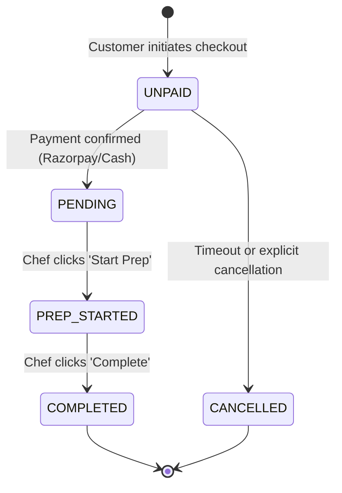
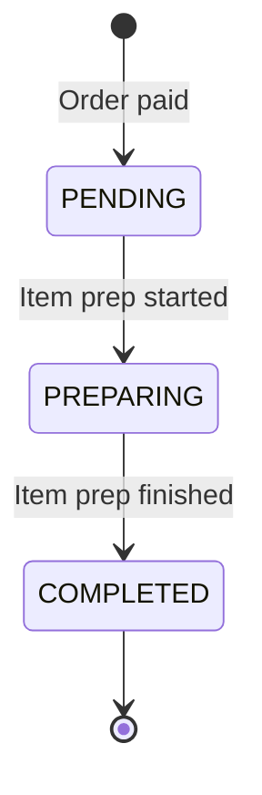

# Order-Flow System Design Details

Last updated: 2026-05-14

This document covers the intricate data flows, state machines, and system interactions within Order-Flow. While `ARCHITECTURE.md` defines *what* the system is, this document defines *how* the system operates.

## 1. Request Lifecycle & Routing

Order-Flow processes requests through distinct execution paths based on the nature of the request.

### 1.1 Standard HTTP Request Flow
1. **Nginx Reverse Proxy**: Terminates TLS, enforces rate limits, serves static files, adds security headers.
2. **Daphne ASGI Server**: Handles HTTP request via Django middleware pipeline.
3. **Middleware Pipeline**:
   - `SecurityMiddleware`
   - `SessionMiddleware`
   - `AuthenticationMiddleware` (Resolves `request.user`)
   - `CsrfViewMiddleware` (Protects against Cross-Site Request Forgery)
4. **URL Router (`urls.py`)**: Directs to the appropriate view based on bounded context.
5. **View Execution**:
   - Evaluates RBAC constraints via mixins (e.g., `ActiveStaffMixin`).
   - Executes business logic within `transaction.atomic()` if state is mutated.
6. **Template/JSON Generation**: Returns SSR HTML or optimized JSON (for Alpine.js clients).

### 1.2 Real-Time WebSocket Flow
1. **Nginx**: Upgrades connection via `proxy_http_version 1.1` and `Connection: upgrade` headers. Routes `/ws/` traffic to Daphne.
2. **Daphne ASGI Layer**: Routes `ws://` traffic to Django Channels.
3. **Consumer (`KDSWebsocketConsumer`)**:
   - Authenticates the user via session state.
   - Subscribes the socket connection to a Redis group: `kds_{restaurant.id}`.
4. **Event Ingestion**: When a backend view triggers `trigger_kds_refresh(restaurant_id)` or `broadcast_payment_update(...)`, the message propagates through the Redis-backed channel layer to all connected Daphne workers, pushing the event to clients.

---

## 2. Core State Machines

### 2.1 Order State Machine
The lifecycle of an `Order` strictly follows these transitions:

### 2.2 Work Unit (Item/Addon) State Machine
Individual items within an order track their own sub-states (`WorkStatus`):

*Design Note: The overall `Order` status is dynamically computed based on the aggregate statuses of its `OrderItem` and `OrderItemAddOn` relations to prevent data anomalies.*

---

## 3. Financial Integrity & Idempotency

### 3.1 Razorpay Webhook Processing
Webhooks arrive asynchronously from Razorpay. To prevent race conditions between user redirects and webhook delivery:
1. The provider payload signature is mathematically verified.
2. A `WebhookLog` row is created with dedupe keys for provider event ID and payload hash.
3. A database lock (`select_for_update`) is acquired on the `Order` and `PaymentTransaction`.
4. If the payment is already confirmed, the webhook becomes a no-op.
5. If `UNPAID`, the system transitions the order to `PENDING`, confirms the stock reservation, creates the platform fee record, and emits both KDS and payment update WebSocket events.

### 3.2 Platform Fee Ledger
`PlatformFeeRecord` is an **append-only ledger table**.
- Records are written atomically at the moment payment is confirmed.
- The `fee_rate_snapshot` field guarantees that historical fee records are never corrupted if the system administrator alters the platform fee percentages in the future.

---

## 4. Frontend Design Pattern (Thick HTML, Reactive JS)

Instead of a heavy SPA (Single Page Application), Order-Flow uses **Hypermedia Driven Applications (HDA)** principles combined with lightweight reactivity:

1. **Owner Dashboard**: Uses standard Django Server-Side Rendering (SSR) for maximum SEO, fast First Contentful Paint (FCP), and simple form submissions.
2. **Kitchen Display System (KDS)**: Requires instant, no-reload reactivity. Instead of React, we use **Alpine.js**.
   - The UI is declared in HTML with `x-data`, `x-show`, and `x-for` directives.
   - State is hydrated via JSON endpoints (`KDSPollView`).
   - This removes the need for Webpack/Vite build steps and keeps the codebase unified in Python/HTML.
