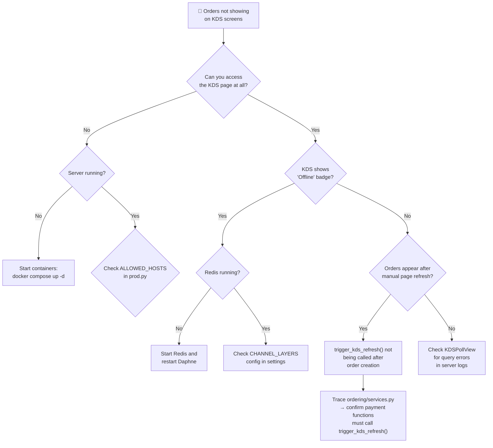
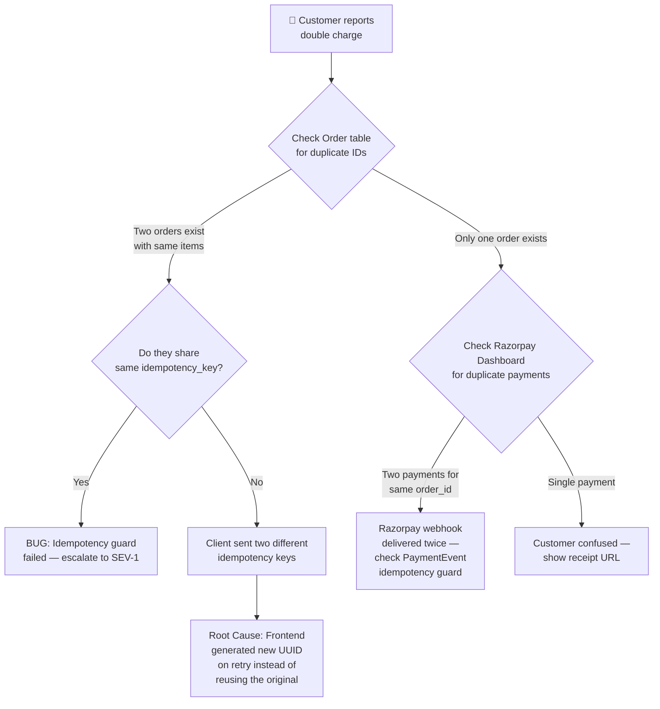
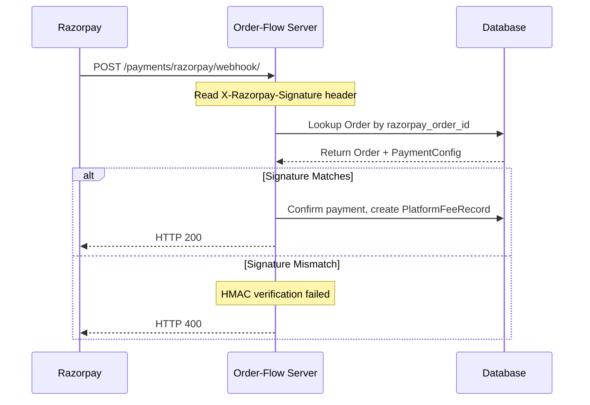
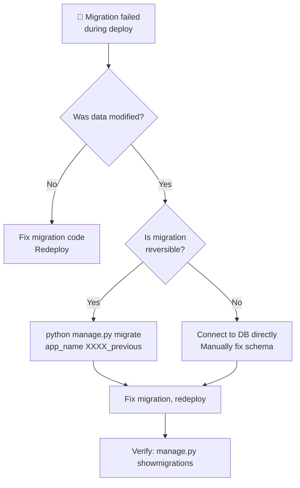
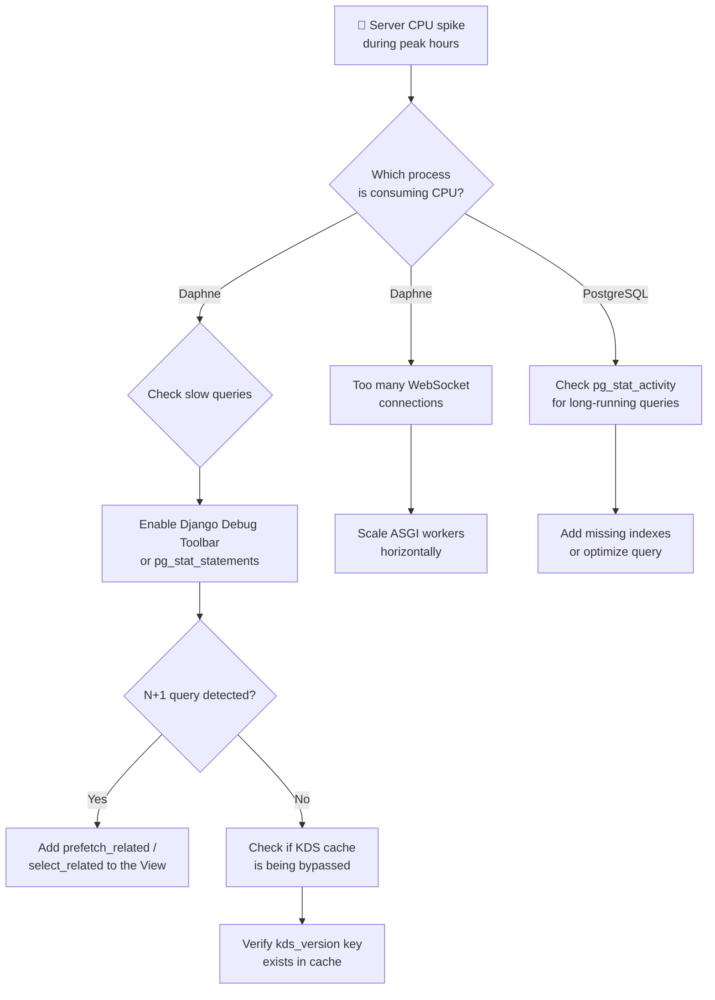

# Order-Flow Troubleshooting & Incident Response

Last updated: 2026-05-08

This document provides structured debugging workflows for the most common production incidents. Each scenario includes a diagnostic flowchart, root cause analysis, and resolution steps.

> **Note**: All commands assume Docker Compose deployment. Prefix shell commands with `docker compose exec web`.

---

## 1. Incident Severity Classification

| Severity | Definition | Response SLA | Example |
|----------|-----------|-------------|---------|
| **SEV-1** | Complete service outage | 15 minutes | Database is unreachable, all restaurants offline |
| **SEV-2** | Partial outage, payments affected | 30 minutes | Razorpay webhook verification failing |
| **SEV-3** | Degraded experience | 2 hours | KDS WebSocket disconnecting intermittently |
| **SEV-4** | Minor issue, no revenue impact | Next business day | Owner dashboard CSS rendering issue |

---

## 2. Scenario: Orders Not Appearing on KDS



### Resolution Steps
1. Check server logs for Python exceptions in `kitchen/views.py`.
2. Verify `trigger_kds_refresh(restaurant.id)` is called after every order state mutation.
3. Confirm the KDS cache is being properly invalidated (check `kds_version_{restaurant_id}` in cache).

---

## 3. Scenario: Customer Double-Charged



### Resolution Steps
1. Look up the customer's order by `customer_name` and `created_at` date.
2. Cross-reference with the Razorpay Dashboard for the restaurant.
3. If a genuine duplicate exists, handle the refund manually in the Razorpay Dashboard and document the action in the admin notes.
4. The application does not process refund webhooks or mutate ledger records for refunds in the current business model.

---

## 4. Scenario: Razorpay Webhook Verification Failing



### Common Root Causes
1. **Webhook secret mismatch**: The `razorpay_webhook_secret` stored in `RestaurantPaymentConfig` does not match the one configured in the Razorpay Dashboard.
2. **Multiple Razorpay accounts**: The restaurant changed their Razorpay account but forgot to update the webhook secret in Order-Flow.
3. **Body encoding**: Rarely, a reverse proxy may modify the request body (e.g., re-encoding JSON), which invalidates the HMAC signature.

### Resolution
```bash
# Verify the stored webhook secret
docker compose exec web python manage.py shell
>>> from core.models import RestaurantPaymentConfig
>>> config = RestaurantPaymentConfig.objects.get(restaurant__slug='slug')
>>> print(config.razorpay_webhook_secret[:4] + '...' + config.razorpay_webhook_secret[-4:])
```
Compare this value with what's configured in the Razorpay Dashboard → Webhooks → Secret.

> **Note**: Payment secrets are masked in Django admin. Use the shell command above for debugging.

---

## 5. Scenario: Database Migration Failure in Production



### Prevention
- **Always test migrations on staging** before applying to production.
- Use `RunPython(reverse_code=...)` in data migrations to make them reversible.
- Run `python manage.py sqlmigrate <app> <number>` to preview the SQL before applying.

---

## 6. Scenario: High Server CPU / Slow Response Times



### Quick Diagnostic Commands
```bash
# Check active database connections
docker compose exec web python manage.py dbshell
=> SELECT count(*) FROM pg_stat_activity WHERE state = 'active';

# Check cache hit rate
docker compose exec web python manage.py shell
>>> from django.core.cache import cache
>>> cache.get("kds_version_<restaurant_uuid>")  # Should return an integer

# Check container health
docker compose ps
curl -f http://localhost/healthz/ready/

# Check Redis
docker compose exec redis redis-cli info stats
```

---

## 7. Post-Incident Review Template

After resolving any SEV-1 or SEV-2 incident, complete the following:

| Field | Description |
|-------|-------------|
| **Incident ID** | Auto-generated or manually assigned |
| **Severity** | SEV-1 / SEV-2 |
| **Duration** | Start time → Resolution time |
| **Impact** | Which restaurants / how many orders affected |
| **Root Cause** | Technical explanation |
| **Resolution** | What was done to fix it |
| **Prevention** | What will be done to prevent recurrence |
| **Action Items** | Specific JIRA tickets / code changes |
