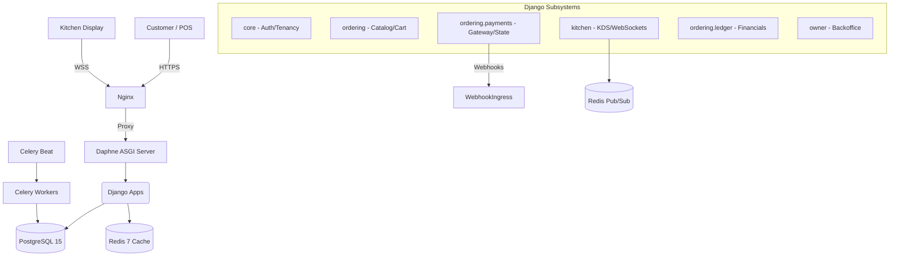

# Architecture Overview

## System Design

Order-Flow is a multi-tenant SaaS application designed to handle high-concurrency restaurant ordering, payment processing, and real-time kitchen operations (KDS).

### Component Map



## Core Tenets & Design Decisions

### 1. Multi-Tenancy (Row-Level Isolation)
- **Isolation Strategy**: Logical isolation via foreign keys. Every primary entity (`MenuItem`, `Order`, `Customer`, `User`) contains a `restaurant_id` foreign key.
- **Enforcement**: Tenant context is injected via `core.mixins` or explicitly passed in service functions. Cross-tenant leakage is prevented by strict ORM filtering in all views (`.filter(restaurant=self.request.user.restaurant)`).

### 2. High Concurrency & Inventory Accuracy
- **Atomic Operations**: Heavy use of `transaction.atomic()` and `select_for_update()` on critical paths (e.g., checkout, KDS state changes).
- **Stock Reservations**: Inventory is held temporarily via `StockReservation` during the checkout flow to prevent overselling. Unpaid reservations are released automatically via Celery `release_expired_reservations_task`.
- **Sequential ID Generation**: Custom counters (`RestaurantOrderCounter`, `RestaurantCustomerCounter`) are used with row-level locks to guarantee sequential, gap-free IDs per restaurant per day.

### 3. Asynchronous Execution (Celery)
- **Queueing Strategy**: Long-running tasks, payment webhook ingestion, and scheduled cleanups are delegated to Celery.
- **Dedicated Queues**: Webhook processing is routed to a dedicated `payments` queue to ensure payment latency isn't affected by general background work.

### 4. Real-Time Kitchen Display (KDS)
- **Transport**: WebSockets via Django Channels + Daphne.
- **State Hydration**: Clients poll initially, then receive WebSocket push events. If the connection drops or is re-established, the KDS fetches full state from `/api/kds/poll/` to guarantee consistency (Eventual Consistency + Push model).

## Project Structure (Domain Driven)

```
dineflow/           # Global settings, ASGI/WSGI entrypoints, root URL conf
core/               # Multi-tenancy, User/Customer auth, Shared Models
ordering/           # Catalog, Cart, Checkout, Order models
  ├── payments/     # Payment orchestration, Webhooks, Verification
  ├── ledger/       # Financial double-entry ledger
  └── inventory/    # Stock reservation management
kitchen/            # WebSockets consumers, KDS API
owner/              # Admin dashboard, Reporting, Menu management
```
