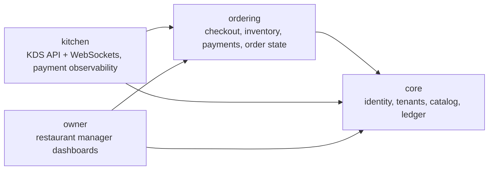

# Architecture Overview

This is the map you should have in your head before opening any code. It
covers what Dineflow is made of, how the pieces talk to each other, and why
the boundaries between them are drawn where they are.

## The stack

| Layer | Technology | Why |
|---|---|---|
| Web framework | Django 5.2 | Mature, batteries-included, strong ORM and admin for a system that's mostly CRUD + business rules |
| Database | PostgreSQL (Supabase-hosted in production) | Strong transactional guarantees, row-level locking — both load-bearing for the payment and inventory logic |
| Real-time transport | Django Channels + Redis | Push live updates to kitchen tablets without polling the database directly |
| Background jobs | Celery + Redis | Run slow/unreliable work (webhook processing, gateway polling) off the request path |
| Payment gateway | Razorpay | UPI + card processing, with a multi-provider abstraction in place for adding others |
| File storage | Supabase Storage (S3-compatible) | Menu images, logos, QR codes |
| Process model | Daphne (ASGI) for web, separate Celery worker + beat processes | WebSockets require an ASGI server; background jobs need their own processes |

## The four Django apps, and why the boundaries are there

Dineflow is one Django project split into four apps. Each app owns its own
models, business logic, and routes — they are not just folders for
organization, they are intentional boundaries.

- **`core`** — Has no dependency on any other app. Owns `Restaurant`
  (the tenant), `User`, `Customer`, the menu catalog (`MenuItem`, `AddOn`),
  platform-wide settings, and the double-entry financial ledger
  (`core/ledger.py`). Everything else depends on `core`; `core` depends on
  nothing else in this codebase.
- **`ordering`** — Owns the full lifecycle of an `Order`: cart pricing and
  validation, inventory locking, the payment gateway integration, webhook
  ingestion, and the order/payment state machines. This is the most complex
  app and is itself split into sub-packages (`checkout/`, `inventory/`,
  `orders/`, `payments/`, `ledger/`) — see
  [Codebase Map](./02-codebase-map.md).
- **`kitchen`** — Owns the Kitchen Display System: the REST endpoints staff
  tap through, the WebSocket consumer that pushes live refresh signals, and
  `PaymentEvent`, an append-only timeline used purely for diagnosing stuck
  or failed payments.
- **`owner`** — Owns every screen a restaurant manager uses: dashboard,
  menu editing, staff management, customer accounts, settings, and
  reconciliation reports. It's a consumer of `core` and `ordering`, not a
  source of new domain logic.

## Inside `ordering`: the service layer

Business logic does not live in views or in models. It lives in
`services.py` files, organized by sub-domain:

| Sub-package | Responsibility |
|---|---|
| `ordering/checkout/services.py` | Validates a cart against the live menu, computes the authoritative price (the client's submitted price is never trusted), and creates the `Order` row |
| `ordering/inventory/services.py` | Locks and decrements stock, creates `StockReservation` holds, restores availability when stock is returned |
| `ordering/orders/services.py` | Order-side state transitions: confirming cash/UPI payments, expiring overdue unpaid orders, computing the platform fee for an order |
| `ordering/payments/services.py` | The payment-gateway side: webhook ingestion, signature verification, idempotency, and the state machine that drives `PaymentTransaction` |
| `ordering/ledger/services.py` | A simpler, order-scoped ledger helper used alongside the double-entry ledger in `core` |

A view's job is to: authenticate the request, call exactly one service
function, and render the result. If you find yourself writing `if`
statements about money, stock, or order status inside a `views.py` file,
that logic is in the wrong place.

## Why side effects use signals, but money does not

Django signals (`order_paid`, `order_cancelled`, `inventory_released`) are
used for side effects that are useful but not financially critical — e.g.,
sending a non-essential notification. They intentionally are **not** used
for anything that touches money or inventory correctness.

The reason: a signal receiver can fail silently, run out of order, or not
run at all in certain edge cases, and Django does not guarantee it runs in
the same database transaction as the code that triggered it. For anything
where a missed update would mean a financial inconsistency — recording a
captured payment in the ledger, decrementing stock — the code calls the
relevant service function **directly**, inside the same
`transaction.atomic()` block as the order's status change. That way the
database itself enforces that "order marked PAID" and "ledger updated"
either both happen or neither does.

## Why background jobs exist at all

Two reasons drive nearly every use of Celery in this codebase:

1. **Don't make a customer's browser wait on a payment gateway.** When
   Razorpay sends a webhook, the web process's only job is to verify the
   signature, store the raw event, and hand it to a background worker. The
   actual processing — updating the order, the ledger, notifying the
   kitchen — happens off the request/response cycle.
2. **Retry automatically, without losing anything.** If a worker crashes
   mid-task (a container restart, an out-of-memory kill), the unacknowledged
   job goes back on the queue and another worker picks it up. See
   [Background Jobs](./08-background-jobs.md) for the specific settings
   that guarantee this.

## Multi-tenancy: how isolation is actually enforced

Every tenant-scoped model carries a foreign key to `Restaurant`, and every
query that returns tenant data is filtered by the restaurant tied to the
logged-in user or the URL's restaurant slug. There is no global "see
everything" query path in the application code for restaurant-scoped data.
Combine this with UUID primary keys (so IDs can't be guessed or enumerated)
and you get the isolation guarantee described in
[What Is Dineflow?](../for-everyone/01-what-is-dineflow.md). See
[Security](./10-security.md) for an important caveat: tenant isolation is
enforced by application code, not by the database's Row-Level Security
feature, even though RLS is enabled.

## Next

[Codebase Map](./02-codebase-map.md) walks the actual directory tree so you
know where to put new code.
