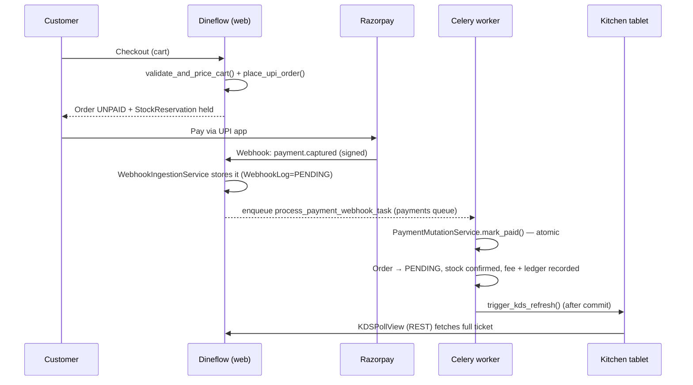

# Order & Payment Lifecycle

This is the most important page in the engineering docs. Almost every
interesting bug, edge case, and design decision in this codebase traces
back to the interaction between two state machines: the `Order.Status`
state machine, and the `PaymentTransaction.state` state machine.

## Why there are two state machines, not one

An `Order` is the customer-facing concept — "what's happening with my
food." A `PaymentTransaction` is the gateway-facing concept — "what's
happening with my money." They're related but not identical, and they
change for different reasons (a kitchen action changes order status; a
bank notification changes payment state). Keeping them separate, with one
explicit place that translates between them (`PaymentMutationService`),
is what makes each one simple enough to reason about on its own.

## The `Order.Status` state machine

```
UNPAID ──► PENDING ──► PREP_STARTED ──► COMPLETED
   │
   └──────► CANCELLED
```

| State | Meaning | Entered when |
|---|---|---|
| `UNPAID` | The default state the instant an order is created. | `place_cash_order()` / `place_upi_order()` / `place_post_payment_order()` in `ordering/checkout/services.py` |
| `PENDING` | Payment confirmed. The ticket is now live in the kitchen. | Cash: staff taps "Collect Cash" (`confirm_cash_payment`). UPI: the webhook-driven `PaymentMutationService.mark_paid()` confirms it. Post-payment: confirmed immediately at checkout, since the customer's account is charged, not a gateway. |
| `PREP_STARTED` | Kitchen has started on at least one item. | Computed by `sync_order_status()`, based on whether any `OrderItem`/`OrderItemAddOn` is `PREPARING`. This state is skipped entirely if the restaurant's `kds_prep_enabled` config is off. |
| `COMPLETED` | Every item and add-on is done. | Computed by `sync_order_status()`, based on whether everything is `COMPLETED` |
| `CANCELLED` | Order will never be fulfilled. | Cash payment timeout, UPI payment failure/expiry, or manual cancellation |

A subtlety: `PREP_STARTED`/`COMPLETED` are not set directly by a "mark this
order as X" action. They're **derived** by `sync_order_status()` from the
actual per-item prep states whenever an item or add-on's status changes.
This means the order-level status is always a true reflection of its
items, never something that can drift out of sync through a missed update.

## The `PaymentTransaction.state` state machine

Defined as data, not as scattered `if` statements, in
`ordering/models.py`:

```python
PAYMENT_STATE_TRANSITIONS = {
    PENDING:    {INITIATED, EXPIRED},
    INITIATED:  {PROCESSING, PAID, FAILED, EXPIRED},
    PROCESSING: {PAID, FAILED, EXPIRED},
    PAID:       {},                     # terminal
    FAILED:     {PAID},                 # late-capture recovery — see below
    REFUNDED:   {},                     # terminal
    EXPIRED:    {PAID},                 # late-capture recovery — see below
}
```

`PaymentStateMachine.transition_locked()` is the single gate every state
change passes through. It raises `ValueError` on any transition not listed
above — there is no path in this codebase where, say, a `PAID` payment can
be silently moved back to `INITIATED`.

## Why `FAILED → PAID` is allowed at all

This looks backwards until you understand the underlying banking behavior
it exists to handle. On India's UPI network, a payment can report a
failure to the customer's app (often due to a timeout talking to NPCI)
**before** the bank has actually finished clearing the transaction. The
money can still land successfully a short time later, and Razorpay will
then send a second, contradictory webhook reporting success.

If Dineflow only trusted the first message, a customer who genuinely paid
would have a cancelled order and a missing meal. So the state machine
explicitly allows recovering a `FAILED` (or `EXPIRED`) payment back to
`PAID` when that late confirmation arrives.

### What "recovery" actually does (`PaymentMutationService.mark_paid`)

When a late-capture webhook is recognized (the order is `UPI`, currently
`CANCELLED`, and the transition is legal):

1. It re-checks current stock for every item and add-on on the order,
   row-locked.
2. **If stock is still available**, it deducts it, creates confirmed
   `StockReservation` rows, reopens the order to `PENDING`, and the ticket
   appears in the kitchen — all inside one atomic transaction.
3. **If stock is no longer available** (it sold out in the meantime), the
   order is *not* silently left in a bad state — the payment record is
   flagged with `manual_recovery_required: true` in its metadata (with a
   snapshot of exactly what was required vs. available), and a
   `PAYMENT_RECOVERY_REQUIRED` event is logged. This is the signal an
   operator should act on; see
   [Incident Playbook](../operations/03-incident-playbook.md).

## How a payment is actually confirmed — the dual-path design

There are two distinct ways Dineflow can learn a payment succeeded, and
they are **not** treated as equally trustworthy:

| Path | Trigger | Trust level |
|---|---|---|
| Synchronous verification | The customer's browser, right after the Razorpay checkout modal closes, calls `POST /payments/razorpay/verify/` | Used only to make the UI feel responsive. Internally it still goes through `PaymentVerificationService` → `PaymentMutationService.apply_provider_event()` — the *same* validated path as a webhook, not a shortcut around it. |
| Asynchronous webhook | Razorpay's servers call `POST /payments/webhook/<provider>/` directly | The authoritative path. Cryptographically signed, server-to-server, and the only path that's resilient to the customer's device losing power or connectivity right after paying. |

Both paths funnel into the exact same `PaymentMutationService`, which is
deliberate: there is only one place in the codebase that is allowed to
move a payment to `PAID`, regardless of which path discovered that fact.

## Idempotency: surviving retries safely

Two different idempotency mechanisms protect two different operations:

- **Order creation** (`Order.idempotency_key`): if a checkout request times
  out on the client side and the client retries with the same key,
  `place_cash_order()`/`place_upi_order()` looks up the existing order by
  that key and returns it rather than creating (and charging for) a
  duplicate.
- **Webhook processing** (`WebhookLog`): every incoming webhook is
  deduplicated by `(restaurant, provider, payload_hash)` plus the
  provider's own event ID, so a redelivered webhook (Razorpay retries, or
  an operator manually clicking "resend" in their dashboard) is a no-op
  the second time.

## End-to-end walkthrough: a successful UPI order



## Next

[Financial Ledger](./05-financial-ledger.md) covers what happens to the
money the instant `mark_paid()` runs.
